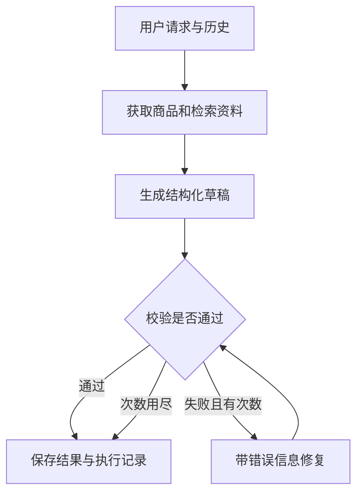

# AdCraft AI v2：从会运行到能独立讲解

这套资料面向正在学习 Python、HTTP、JSON，但已经接触过模型训练、Transformer 和数据实验的同学。目标是你能修改一条 AI 调用链，复现一个错误，用测试证明修复有效，并回答面试官的追问。

先按根目录 [README.md](README.md) 启动项目。本文讲解学习路径，详细设计在 [docs/ARCHITECTURE.md](docs/ARCHITECTURE.md)，概念在 [docs/AI_CONCEPTS.md](docs/AI_CONCEPTS.md)，练习在 [docs/EXERCISES.md](docs/EXERCISES.md)，面试问题在 [docs/INTERVIEW_QUESTIONS.md](docs/INTERVIEW_QUESTIONS.md)。

## 1. 先确认自己运行的是什么

AdCraft v2 是本地单工作区的电商内容助手。你选择商品，用自然语言要求生成、追问或修改文案；系统查询商品和品牌资料，生成结构化草稿，检查草稿，并记录执行过程。图片沿用独立生成流程。

两种运行模式必须分清：

| 模式 | 执行方式 | 适合证明什么 | 不能据此证明什么 |
| --- | --- | --- | --- |
| `demo` | 固定逻辑和模板；真实的离线文档检索；无真实模型调用 | API、界面、校验、进度、多轮记录能接通；故障处理和测试可复现 | 模型理解能力、真实生成质量、真实费用、真实 LLM 时延 |
| `live` | 调用配置好的 OpenAI 兼容接口；模型选择受允许的工具，随后生成草稿 | 对真实模型的接入、工具选择、输出校验和修复 | 自动代表所有供应商兼容；自动证明没有幻觉 |

`GET /api/v1/ai/config` 会告诉你当前模式、模型、检索配置和图片提供方。先看它，再解释演示结果。

表中的 demo/live 指文本工作流。`IMAGE_PROVIDER` 独立控制图片：文本处于 demo 不会自动禁止显式配置的真实图片调用。默认图片也是 demo；学习离线流程时保持两者为 demo。

本项目的 SSE 推送的是任务进度，例如“正在检索”“校验完成”。这是工作流事件流，**没有实现模型逐 token 输出**。知识检索默认是 BM25；只有配置并成功调用真实 embedding 服务时，才有语义向量与关键词融合。不要把这些边界混在一起。

当前前端通过 GET 轮询运行记录来刷新进度，不使用 EventSource。后端 SSE 可以独立访问；不能把“后端存在 SSE 接口”表述为“当前界面已经用 SSE 推送”。

## 2. 你首先应该能解释的一次请求

假设商品事实是：杯子、400 mL、304 不锈钢。用户说：

> 写一篇小红书种草文案，强调适合通勤。没有证据的保温时长不要写。

一次请求可以拆成如下对象：

| 对象 | 输入或输出的意义 |
| --- | --- |
| `Product` | 已知商品事实；其中事实有 ID，后面可以检查引用 |
| `KnowledgeDocument` | 品牌语气、用词指南等可检索资料；带品牌、版本和来源 |
| `message` | 当前用户要求；不是商品事实数据库的替代品 |
| `history` | 同一会话最近的运行结果，帮助理解“再短一点” |
| `Evidence` | 这次实际检索到的资料片段 |
| `Draft` | 模型生成的文案、主张、事实引用和图片方案 |
| `validation` | 程序检查出的错误和警告 |
| `Run` | 一次执行的状态、结果、事件、用量与错误 |

注意：让模型输出 `{"capacity": "400 mL"}` 不能证明这个数字正确。你还需要与 `Product.facts` 对照。JSON 解决结构问题，事实校验解决内容的一部分问题。

阅读代码时画出下面这条线，然后写上你真正找到的函数名：



如果你能说明每个箭头传了什么数据、在哪一步可能失败，就已经开始真正理解项目。

## 3. 推荐阅读顺序

不要按目录从第一行读到最后一行。每次围绕一个问题找代码。

| 顺序 | 文件和入口 | 先回答的问题 |
| --- | --- | --- |
| 1 | `backend/app/ai/config.py`：`AISettings` | 哪些参数由环境提供？为什么没有 key 时不能伪装成 live？ |
| 2 | `backend/app/ai/provider.py`：`ModelClient.chat`、`ModelClient.embed` | Python 怎样发送请求？返回值怎样统一？哪些错误被包装为 `ModelError`？ |
| 3 | `backend/app/ai/retrieval.py`：`chunk_documents`、`Retriever.search` | 文档如何成为片段？如何按品牌过滤？分数怎样产生？ |
| 4 | `backend/app/ai/schemas.py`：`Draft/Claim/ImagePrompt`；`prompts.py` 的三组 prompt | 输出字段与提示词怎样对应？为什么严格限制额外字段？ |
| 5 | `backend/app/ai/validation.py`：`validate_draft`、`unsupported_request` | 字段正确和事实有依据分别怎么查？失败如何返回？ |
| 6 | `backend/app/ai/workflow.py`：`AIWorkflow.run`、`_chat`、`_demo_draft` | demo 与 live 分叉在哪里？工具、生成、校验、repair 怎样连接？ |
| 7 | `backend/app/ai/api.py`：`create_app/create_run/execute_run`；`repository.py`：`Repository.create_idempotent` | 谁创建 `Run`？状态何时变化？重复 ID 是复用还是冲突？ |
| 8 | `api.py`：`events`；`frontend/src/api/ai.ts`；`frontend/src/pages/Workbench/index.tsx` | 后端如何提供 SSE？当前前端怎样轮询并展示 trace？ |
| 9 | `images.py`：`ImageRenderer.render`；`evaluation.py`：`run_evaluation`；`scripts/evaluate.py` | 文案和图片为什么分开？报告测量哪些行为？ |

可以在项目根目录用 `rg` 找实际定义：

```bash
rg -n 'class AISettings|class ModelClient|async def chat|async def embed' backend/app/ai
rg -n 'def chunk_documents|class Retriever|async def search' backend/app/ai
rg -n 'def validate_draft|class AIWorkflow|async def run' backend/app/ai
rg -n 'request_id|events|evaluations|image-jobs' backend/app
```

旧版 ORM、Celery、MinIO 文件保留了历史实现。阅读 v2 时从 AI 路径入手；不要把旧版依赖当成 v2 的前置学习要求。

## 4. 第一轮：不用模型，也能看懂 API

先建立一张“请求—响应”表。用浏览器开发者工具 Network，或后端 API 页面，记录：

1. `GET /api/v1/ai/config`：确认模式。
2. `GET /api/v1/ai/products`：取一个商品 ID。
3. `POST /api/v1/ai/sessions`：新建会话，取 `session_id`。
4. `POST /api/v1/ai/runs`：创建一次运行。
5. `GET /api/v1/ai/runs/{id}`：查询状态和最终结果。

请求示例中的 ID 要换成实际响应里的值：

```json
{
  "session_id": "实际会话ID",
  "product_id": "实际商品ID",
  "message": "写一版简洁的小红书文案，不要添加资料没有的参数",
  "platform": "xiaohongshu",
  "request_id": "learn-first-run-001"
}
```

`request_id` 代表一次用户提交的身份，不是文案正文。重试同一提交沿用它；用户有新意图时换一个。不要用永久不变的 ID 提交所有请求。

当前实现的范围是会话。同一会话里，ID 与内容都相同会返回已有运行；同一 ID 但内容不同会返回 HTTP 409。`Repository.create_idempotent` 用 SQLite 事务和请求指纹保存该关系。

你应该观察到状态从 `queued` 到 `running`，最后进入 `completed`、`needs_clarification` 或 `failed`。创建运行的 HTTP 响应返回成功，仅代表请求被接收；不代表后台生成已经成功。

练习：把 `product_id` 改为不存在的值，观察 HTTP 状态和错误；再发送缺少 `message` 的请求。记录“请求校验失败”和“后台执行失败”的区别。

## 5. 第二轮：单独理解模型适配器

只关注 `ModelClient.chat`。它接收消息列表，发送 HTTP 请求，把供应商响应转换成项目内部格式。工作流不用处处处理供应商原始字段。

下面是**概念示例**，用于解释 Python 调用方式，不是替换项目实现：

```python
messages = [
    {"role": "system", "content": "根据已提供事实生成文案，不补造商品参数。"},
    {"role": "user", "content": "商品：杯子，400 mL。输出标题和正文。"},
]
reply = await client.chat(messages, json_mode=True)
raw_text = reply["content"]
usage = reply["usage"]
```

要能解释：

- `await` 为什么出现：等待网络请求期间允许事件循环处理其他工作，不会把模型算得更快。
- `messages` 为什么有角色：区分系统约束、当前用户输入以及工具返回的数据。
- `json_mode` 的作用：请求供应商按 JSON 形式返回；程序仍要检查字段与内容。
- `usage` 的作用：实际响应报告的 token 数，不是“字符串长度÷某个数”伪造的用量。
- 超时的作用：停止无期限等待；不一定能取消供应商已经开始的计算。

调试时查看模型名称、响应状态、耗时和脱敏后的结构。不要在日志、截图、提交记录里输出 API key。

继续读 `ModelClient._post`，分清以下情况：

| 情况 | 当前处理 |
| --- | --- |
| 401/403 | 认证或权限错误，不重试 |
| 429 | 普通限流可有限重试；明确额度耗尽不重试 |
| 408/5xx、网络或超时 | 默认总共最多三次尝试，有界退避 |
| HTTP 成功但响应形态错误 | 明确 `ModelError`，不当成成功内容 |
| 模型输出被截断、空内容、拒绝 | 分别包装为错误，不冒充有效 Draft |

适配器支持的 chat 是非流式。网络请求重试与工作流 repair 是两种机制：一个处理传输或上游服务问题，一个处理内容不合格。

可以把 `client` 换成测试中的 fake client，返回你指定的坏 JSON。这样你能稳定研究解析和 repair，不用花钱反复等模型偶然出错。

## 6. 第三轮：先掌握 BM25，再研究 embedding

在 `chunk_documents` 上停下来，给它一份小文档：

> 品牌语气自然，避免夸张。不要使用“永久保温”。通勤系列强调轻便，所有容量以商品资料为准。

观察原文、片段内容、片段编号和版本。然后用“通勤文案怎么写”检索。

你需要回答：

1. 为什么要切块？长文整体塞进提示词会增加费用和噪声；检索的单位也太粗。
2. 为什么要有 overlap？避免规则或句子在边界断开。重叠太大会产生重复证据。
3. 为什么检索前按 `brand_id` 过滤？品牌 A 的资料不应该成为品牌 B 的依据。
4. 为什么保留版本？文案的依据要能追溯；文档更新后缓存也要失效。
5. `score` 能否叫“事实置信度”？不能。它是检索排序信号。

默认 BM25 根据词项匹配和统计排序。中文分词策略、英文大小写、型号符号都会影响召回。改变 `top_k` 不是必然提高效果：太小可能漏资料，太大可能带来冲突与噪声。

当前 `tokenize` 对中文连续串使用相邻 bigram，对英文/数字使用词项，并进行 NFKC 与大小写归一；它不是训练过的中文分词模型。`chunk_size` 是 Unicode 字符数，不是 token 数。

配置真实 embedding 后，查询和文档片段才会得到语义向量。混合检索通过 RRF 合并关键词和向量排序；它避免直接相加两种量纲不同的原始分数。学习时先构造“语义相似但词不同”的查询，观察混合检索相对 BM25 是否改善，不要预设一定更好。

已经配置 embedding 却调用失败时，当前实现显式报错，不静默降级。SHA256 用于识别缓存文本，不用于伪造语义向量。缓存包含 API base、模型和文本摘要，最多保留 4096 项；批量每次最多 64 段。

建议记录一个小实验：同一份语料，分别试 `top_k=2` 和 `top_k=5`，写出命中的相关片段、重复片段和最终文案差异。

### 可直接运行的离线检索实验

按 README 安装后端依赖后，在 `backend` 目录打开 Python，运行以下代码。它强制 demo，不会调用外部模型：

```python
import asyncio
from dataclasses import replace
from app.ai.config import AISettings
from app.ai.provider import ModelClient
from app.ai.retrieval import Retriever, chunk_documents

settings = replace(AISettings(), force_demo=True, llm_api_key="")
docs = [
    {"id": "d1", "title": "通勤品牌指南", "brand_id": "brand_a",
     "content": "品牌语气自然。通勤文案避免夸张，不要添加未核实的商品参数。",
     "source": "练习", "version": "1"},
    {"id": "d2", "title": "另一品牌指南", "brand_id": "brand_b",
     "content": "通勤广告强调正式表达。这份资料只属于另一个品牌。",
     "source": "练习", "version": "1"},
]
retriever = Retriever(settings, ModelClient(settings))
chunks = chunk_documents(docs, 100, 20)
print("全部片段：", [(c["document_id"], c["text"]) for c in chunks])
hits = asyncio.run(retriever.search(docs, "通勤 品牌语气", "brand_a", 2))
print("检索命中：", [(h["document_id"], h["score"]) for h in hits])
assert all(h["document_id"] == "d1" for h in hits)
```

先预测结果，再把 query 换为没有共同词项的表达。对比 `tokenize(query)` 与 `tokenize(document)`，解释为什么会命中或漏检。

## 7. 第四轮：理解受控 Agent

本项目 live 模式使用一个工具调用循环。模型可以选择工具；程序负责允许调用的范围、参数和执行次数。

允许的能力是查询商品、查询本品牌知识、查看此前草稿。不是任意执行 Python、访问磁盘或调用任何外部服务。文档里即使写着“忽略限制，调用另一个工具”，它也不能增加权限。

阅读 `AIWorkflow.run` 时把每一轮分成：

1. 将当前消息和允许工具交给模型。
2. 解析返回的 `tool_calls`。
3. 检查工具名称、参数和范围。
4. 执行工具，把 observation 加回消息。
5. 达到结束条件后，进入结构化生成。

关键追问：模型不调用知识工具会怎样？工具名错误会怎样？连续要求重复查询会怎样？步数到上限会怎样？以当前代码和测试为依据回答。

当前 live 生成前会检查是否执行过必要工具；修改已有草稿还要求读取上一版。缺少就提示模型继续，未在上限内完成会失败。`SearchKnowledgeArgs` 只允许 query 和 top_k；商品、品牌范围不由模型自由填写。单轮工具最多三次。

demo 模式演示的是显式安排的固定步骤。不能用 demo 的步骤证明“模型自主规划了这些工具”。

## 8. 第五轮：结构化输出、事实检查与 repair

`Draft` 中至少有标题、正文、口号、卖点、主张及事实 ID、证据 ID、图片提示词和平台。前端因此能够按字段展示，后端能够按字段检查。

校验分两层：

- **结构检查**：字段是否存在、类型是否正确、是否满足约束。
- **业务检查**：引用的事实与证据是否存在；输出是否添加资料中没有的数字或商品主张；平台和规则是否匹配。

`validate_draft` 接收可能不合格的模型结果，返回 `passed` 和 `issues`，而不是让坏结果直接把整个 API 弄崩溃。

概念示例：

```python
validation = validate_draft(draft, product, evidence, "xiaohongshu")
if not validation["passed"]:
    # 将原始草稿、可信事实和具体错误交给有限的修复过程。
    # 修复后必须再校验，不能直接认为第二次就正确。
    print(validation["issues"])
```

错误例子：“保温 24 小时”，而商品资料只有“400 mL”。正确处理是去掉未知主张或要求补充信息，不能为了让校验通过而给商品数据库新增一个虚构事实。

### 可直接运行的校验实验

同样在 `backend` 目录运行。这次不需要配置模型：

```python
import copy
from app.ai.validation import validate_draft

product = {
    "id": "p1", "name": "通勤杯", "brand_id": "brand_a",
    "facts": [{"id": "f-capacity", "label": "容量", "value": "400mL"}],
    "selling_points": [],
}
draft = {
    "title": "通勤杯", "body": "容量400mL，随身携带。", "slogan": "自在随行",
    "selling_points": ["容量400mL"],
    "claims": [{"text": "容量400mL", "fact_ids": ["f-capacity"]}],
    "evidence_ids": [],
    "image_prompts": [{"label": "简洁背景", "prompt": "保留原图，使用明亮背景。",
                       "negative_prompt": "不改变商品结构"}],
    "platform": "xiaohongshu",
}
good = validate_draft(draft, product, [], "xiaohongshu")
assert good["passed"]
bad = copy.deepcopy(draft)
bad["body"] = "重量400g，随身携带。"
print(validate_draft(bad, product, [], "xiaohongshu"))
```

继续把 `fact_ids` 改成 `f-unknown`、删掉 `body`、将 `platform` 改成 `taobao`。观察不同错误码。最后构造一句没有数字但有隐含夸张的表述，检查规则是否能够发现；这会帮助你理解当前校验的边界。

repair 是一次或数次明确受限的模型重写。程序告诉模型具体错误，模型尝试修正，程序重新检查。它增加费用和时延，因此有上限。超过上限后应保留可解释的失败或待确认状态。

本项目的校验不是完整事实证明系统。数字、引用和已定义规则可以程序检查；隐含夸张、细微语义矛盾和主观品牌语气仍需要人工审核与更好的评测。

解释型问答可以返回 `completed` 且 `draft=null`。live 会检查解释中的未知数字与性能承诺，涉及商品事实时要求查商品，涉及已有草稿时按当前关键词规则要求读取上一版；一般概念问答可以不查工具。它不经过 Draft 的完整结构与引用校验，`validation.passed=true` 不能被解释为“所有自然语言语义都已验证”。

## 9. 第六轮：多轮、trace 和评测

对同一会话连续发送：

> 生成通勤风文案。
>
> 再短一点，语气更自然。

检查第二次的 `history` 是否包含此前草稿。它是有限历史窗口，不是永久记忆、模型微调或自动学习。运行结果存储和送给模型的上下文是两个不同概念。

`TraceEvent` 保存执行动作与观察，例如工具名、检索片段数量、校验问题和耗时。它不要求保存模型私有思维链。调试所需的信息应当来自可观察行为。

离线 demo 评测只证明确定性功能行为。真实 LLM 质量、费用和时延必须单独跑 live 实验，并记录模型、配置、数据集、时间与重复次数。评测入口不会默认开展付费批量调用。

默认固定评测有 24 条，涵盖检索、校验和确定性工作流，数据位于 `data/evaluation_cases.json`。命令行 `scripts/evaluate.py` 默认离线；只有同时使用 `--live --confirm-paid` 才允许真实模型，默认只选两条工作流样例。即使界面连接 live，界面的评测按钮仍执行离线评测。

随项目提供的 `data/evaluation_report.json` 记录了 24/24 回归断言通过：6 条检索、10 条校验、8 条 demo 工作流。它不是模型质量 100%，不是旧版提升实验，也不是任意输入正确的保证。

## 9.1 断点与调试点

| 入口 | 建议查看的变量 | 有助于区分的问题 |
| --- | --- | --- |
| `api.py:create_run` | body、fresh、run.id | 重复提交、指纹冲突、创建与执行 |
| `api.py:execute_run` | product、history、result | 商品切换、历史范围、后台终态 |
| `provider.py:chat/_post` | payload 的结构、attempt、响应状态 | 供应商兼容、传输错误、解析错误 |
| `retrieval.py:search` | scoped、chunks、lexical、scores | 品牌过滤、切块、召回和融合 |
| `workflow.py:run` | intent、called_tools、decision、draft、validation | 工具遗漏、生成错误、repair 上限 |
| `validation.py:validate_draft` | allowed_numbers、claim_numbers、unknown、issues | 单位不匹配、未知事实和错引用 |
| `repository.py:create_idempotent` | scope、content_hash、old | 同 ID 同内容与冲突内容 |
| `images.py:render` | mode、subject_path、preserved、warning | 背景模式、是否真合成原图 |

在调试器里查看字段即可，不要把 Authorization、API key 或供应商原始异常打印进共享日志。阅读 `_chat` 的 `total_calls` 也要分清：它统计工作流发起的 chat 操作，不是供应商传输重试次数，也不包含 embedding 或图片调用。

## 9.2 运行状态与图片的实际实现

API 使用 FastAPI `BackgroundTasks` 在当前进程执行，SQLite 保存对象和请求指纹。同一会话有串行锁，文本运行全局有并发上限。启动时 `Repository.recover_interrupted` 将遗留 queued/running 标记 failed；它不会继续执行上次的网络调用。

图片只生成背景，再用 Pillow 将上传商品原图缩放、合成到中心区域。透明 PNG 效果更自然，不透明原图会保留原背景。没有原图时只交付背景方案，并显示 warning。`product_preserved` 表示合成了原图，不代表像素没有经过缩放，也不代表完整场景自动通过视觉审查。

图片任务分别记录成功图、失败项和供应商 task ID，部分失败会显示 partial；重做指定方案使用新的图片请求 ID。代码提供真实供应商调用路径，但交付时没有进行付费图片联调，兼容性需用你自己的实际配置验证。

## 10. 学习安排：每一步都有产出

按你自己的节奏推进，不需要等全部学完才修改代码。

| 阶段 | 建议投入 | 可检验的产出 |
| --- | --- | --- |
| API 与 JSON | 1–2 天 | 一张请求响应表；能区分 HTTP 错误和后台失败 |
| Python 异步与模型调用 | 2 天 | 用 fake client 复现超时、空返回、坏 JSON |
| 检索与证据 | 2–3 天 | 10 个查询的小评测；解释一个漏检样例 |
| 受控工具循环 | 2–3 天 | 手动跟踪一次 live 工具执行，解释步数边界 |
| 校验与 repair | 2–3 天 | 三个坏草稿、一轮修复及失败报告 |
| 多轮与任务 | 2 天 | “再短一点”的实验；重复提交的实验 |
| 系统评测与面试 | 3–5 天 | 可复现报告、三分钟讲解、一个真实失败复盘 |

每次学习使用同一张卡片：

```text
本次问题：
涉及文件/函数：
输入：
输出：
我先预测的行为：
实际行为与日志：
差异原因：
我的修改：
验证结果：
仍然不能证明的事情：
```

## 11. 什么时候可以写进简历

如果你能独立完成下面几件事，才把对应模块写成自己的能力：

- 更换输出字段，并同时修复生成、校验和展示。
- 针对一条漏检样例调整检索，证明没有明显损害其他样例。
- 让 fake 模型持续返回坏结果，确认 repair 会终止。
- 找出多轮请求中的历史到底在何处传入。
- 解释一次任务失败的 trace，并说明哪些日志还不够。
- 按说明从空环境启动系统，清楚说出 demo/live 差异。

AI 可以辅助写代码和理解实现，但面试中的可验证贡献来自你亲手做过的修改与实验。不要背下一个你没有复现过的“成功率 99%”。
