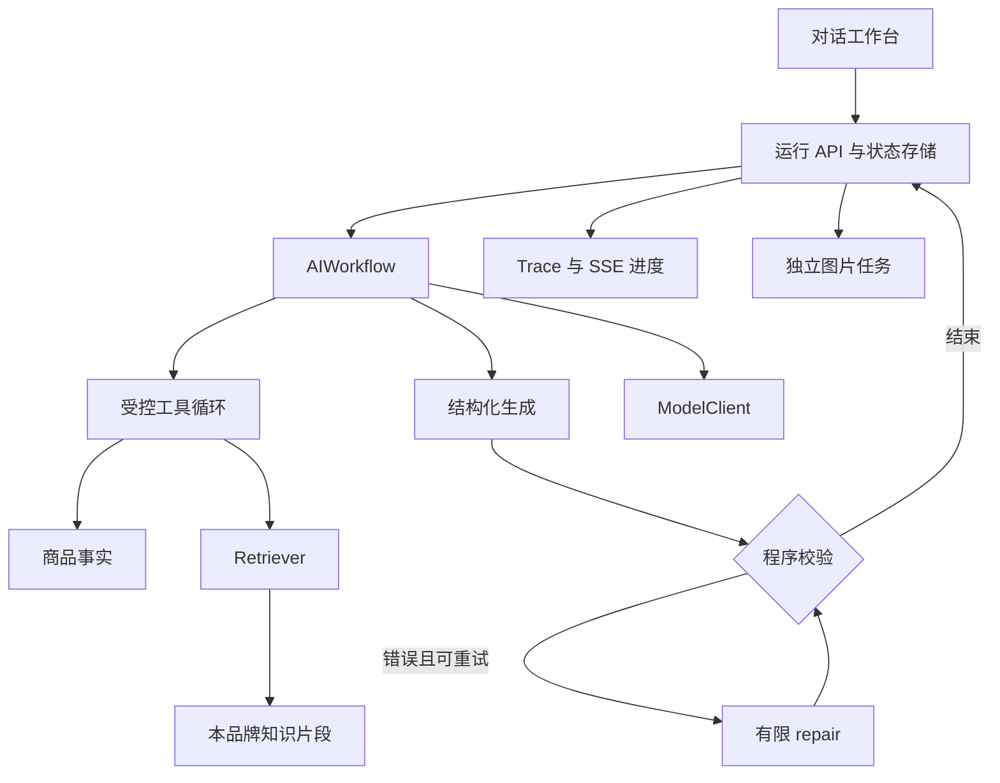
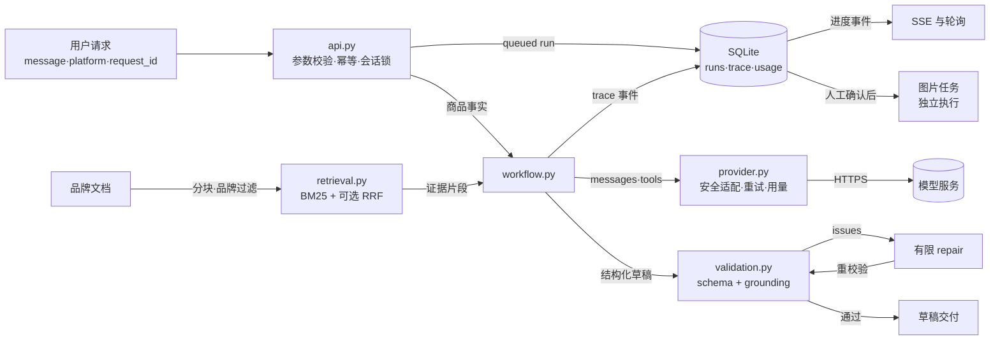
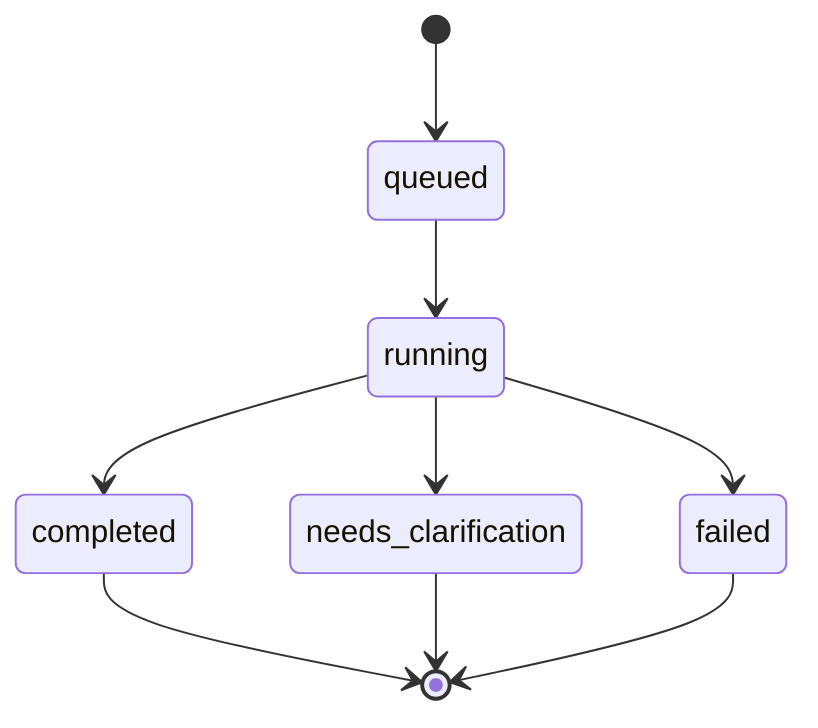

# AdCraft AI v2：架构、边界与设计理由

## 1. 产品范围

这是一个单工作区、本地教学与演示用途的电商内容助手。主流程是自然语言请求、商品事实、品牌资料检索、受控工具调用、结构化草稿、校验及有限修复。基础设施服务于这条链路。

`backend/app/main.py` 调用 `api.create_app`。当前持久化使用本地 SQLite，后台执行是 FastAPI `BackgroundTasks`；启动不依赖 PostgreSQL、MinIO 或 Celery。

本版本没有把生产级多租户、分布式任务可靠性、全面事实证明或投放转化分析作为已完成能力。`brand_id` 过滤是品牌资料范围约束，不等同于登录用户之间的完整权限隔离。

v1 的批量内容生产流水线（Celery + PostgreSQL + Redis + MinIO）已从代码库移除，演进决策见 CHANGELOG；完整 v1 代码保留在 git 历史中。

## 2. 执行关系



文案调用和图片调用分别创建可查询结果。图片必须由用户明确发起，文案执行不会隐式触发付费图片生成。

图中的事件服务是后端 SSE 能力。当前 `frontend/src/pages/Workbench/index.tsx` 使用轮询读取 Run 与图片任务，约 850ms/1000ms 刷新，失败后有界延长等待；没有 EventSource 连接。接口存在与前端传输选择是两个事实。

### 数据流与信任边界



信任边界体现在图的结构里：模型输出（工具参数、决策 JSON、草稿）一律视为不可信输入，先过 `schemas` 与 `validation` 再使用；工具 observation 是数据，不是新的系统指令。进程唯一的对外出口是 `provider.py` 与 `images.py`，两者都不记录响应正文、URL 与密钥；结构化日志走字段白名单（`observability.py`），敏感字段即使误传也会被丢弃。

## 3. 稳定接口与模块责任

| 文件 / 入口 | 责任 | 不应该承担的责任 |
| --- | --- | --- |
| `backend/app/ai/config.py` / `AISettings` | 配置模型、检索、次数、超时与模式 | 生成业务内容或保存 key 到结果 |
| `backend/app/ai/provider.py` / `ModelClient` | 适配兼容 API、解析响应、记录用量、包装错误 | 决定哪些商品主张可信 |
| `backend/app/ai/retrieval.py` / `chunk_documents`、`Retriever.search` | 分块、品牌过滤、BM25、可选语义向量、融合排序 | 给予文档工具权限或保证全文正确 |
| `backend/app/ai/workflow.py` / `AIWorkflow.run` | 编排取证、生成、校验和修复 | 信任任意工具名或无限重复调用 |
| `backend/app/ai/validation.py` / `validate_draft` | 结构与可执行的 grounding 检查 | 宣称证明任意自然语言事实 |
| `backend/app/ai/schemas.py` / `Draft/Claim/ImagePrompt` | 严格定义草稿与工具参数 | 将结构完整等同于语义真实 |
| `backend/app/ai/prompts.py` / 三类 prompt 与 `TOOLS` | 版本化规划、生成与修复要求 | 用提示词替代实际执行权限 |
| `backend/app/ai/api.py` / `create_app`、嵌套路由 | 接收请求、执行后台工作、SSE 与结果 | 提供生产级任务恢复保证 |
| `backend/app/ai/repository.py` / `Repository` | SQLite 存储、事务去重、trace | 替代用户身份与多租户隔离 |
| `backend/app/ai/images.py` / `ImageRenderer` | 背景生成与原图合成 | 把文生图称为商品结构保真编辑 |
| `backend/app/ai/evaluation.py` / `run_evaluation` | 默认离线固定回归样例 | 默认触发付费模型批量实验 |

模块之间传递普通字典和约定的输出对象，AI 核心不导入旧版 ORM 或业务配置。这样可以用 fake client 和小字典单独测试，也方便将模型服务换成另一个兼容实现。

## 4. 数据契约

### 商品事实

```json
{
  "id": "product_demo",
  "name": "通勤水杯",
  "brand_id": "brand_demo",
  "facts": [
    {"id": "capacity", "label": "容量", "value": "400 mL"},
    {"id": "material", "label": "材质", "value": "304 不锈钢"}
  ],
  "selling_points": ["适合通勤携带"]
}
```

事实 ID 是引用与检查的连接点。ID 存在并不自动证明主张含义匹配，还需要内容检查。

### 品牌知识与证据

`KnowledgeDocument` 包含 `id/title/content/brand_id/source/version`。检索后形成 `Evidence`：

```json
{
  "id": "片段唯一ID",
  "document_id": "文档ID",
  "title": "品牌写作指南",
  "text": "语气自然，不使用没有证据的保温时长。",
  "score": 0.73,
  "source": "manual",
  "version": "1",
  "chunk_index": 0
}
```

这里的分数只是示例。BM25 和 RRF 的实际分数不能用同一个阈值解释，也不代表真实性概率。

### 草稿

`Draft` 的主要字段是：

| 字段 | 用途 |
| --- | --- |
| `title/body/slogan/selling_points` | 可展示与编辑的内容 |
| `claims[].text` | 模型声称的商品信息 |
| `claims[].fact_ids` | 主张关联的商品事实 |
| `evidence_ids` | 关联本次检索到的知识片段 |
| `image_prompts[]` | 图片方案的标签、提示词与负面提示词 |
| `platform` | 目标平台及对应约束 |

商品事实、品牌文档、当前用户要求是不同的来源。用户要求改变写作风格，并不自动修改商品参数；资料不足时要降低主张强度或澄清。

`slogan` 字段必须存在，但允许空字符串以表达“删除口号”。标题和正文等仍有非空要求。业务意图变化时，schema、生成、校验和展示需要一起调整。

### 运行

`Run` 保存 `id/session_id/product_id/message/platform/status/mode/answer/draft/evidence/trace/validation/usage/error/created_at/updated_at`。

`usage` 为模型调用报告的输入 token、输出 token、调用次数和时延。demo 不应伪造真实 token 消耗。文本模型用量不自动包含图片提供方的账单。

当前 `total_calls` 统计工作流发起的 chat 操作；适配器内部传输重试、embedding 和图片不在这个计数中。`latency_ms` 是工作流整体执行耗时，不包含排队等待，也不是每个阶段的时延统计报告。

## 5. 一次运行的时间顺序

1. API 检查会话、商品、消息、平台和请求 ID。
2. 创建或返回运行记录，状态为 `queued`。
3. 后台开始，状态为 `running`。
4. 工作流收到商品、品牌文档和有限历史。
5. demo 执行固定取证步骤；live 进入模型驱动的受控工具循环。
6. 生成结构化草稿，解析与校验。
7. 对可修复的错误进行有限 repair；每次重新校验。
8. 保存 `completed`、`needs_clarification` 或 `failed` 状态与结果。



待澄清结果结束当前运行，用户补充信息会创建新运行。它不是服务器在同一个后台函数里无限等待用户。

## 6. RAG 的具体设计

RAG 在这里负责取得与写作有关的品牌和内容规则。精确商品字段直接读取商品对象，避免把价格和容量等数据也变成模糊检索问题。

离线步骤：按品牌限定文档 → 分块 → tokenize → BM25 评分 → 选取片段。中文 tokenization 是简化策略，实际效果需要用查询样例检验。

可选混合步骤：为查询和片段请求真实 embedding → 余弦相似度排序 → 用 RRF 融合语义和关键词排名 → 选取片段。共享 `Retriever` 可以保留缓存；缓存键包含模型身份与文本内容信息，避免仅按文档 ID 复用旧向量。

RRF 常见形式：

\[
\operatorname{RRF}(d)=\sum_{s}\frac{1}{k+\operatorname{rank}_{s}(d)}
\]

`s` 是一个检索列表，`k` 是平滑常数，排名越靠前贡献越大。公式解释融合原理；实际常数以源码为准。

选择 BM25 为默认值的理由：离线能运行、排名能解释、没有额外模型费用，也适合包含型号、规格和明确词项的资料。局限是同义表达、中文切分和长距离语义理解。混合检索增加费用与延迟，是否值得要通过同一评测集比较。

证据来源被展示，方便人核查；它不意味着系统自动证明引用文档是真实或最新的。

## 7. Agent 的控制边界

允许工具包括 `get_product`、`search_knowledge`、`inspect_previous_draft`。程序决定实际商品与品牌范围，模型不能通过参数读到任意品牌。

模型的工具选择和参数视为不可信输入，需要与工具 schema 和服务端规则对照。工具 observation 是数据，不是新的系统指令。

`max_agent_steps` 限制决策循环，`max_repair_attempts` 限制重写次数。这两个参数分别控制取证和修复，不应该混为一个“最大重试”。

替代方案是固定工作流：明确调用商品与知识工具，再生成。固定流程的可预测性更高；Agent 更适合“查规则”“改上一版”“生成新草稿”等不同意图。项目保留受控结构，不需要多个 Agent 才算 Agent。

## 8. 输出校验及其边界

结构校验检查类型、必需字段和数据形态。grounding 校验检查可识别数字、商品事实引用、证据引用及预定义业务规则。错误应进入 `issues`，不能靠添加默认口号将未知内容伪装成有效。

repair 输入包括原始输出、可信商品事实、证据和具体问题；输出仍需完整校验。模型自称“已修复”没有效力。

解释型 live 答案另用 `unsupported_request` 检查未知数值和承诺；商品事实解释按当前关键词规则要求 `get_product`，已有草稿解释在需要时要求 `inspect_previous_draft`。一般概念问答允许直接回答。该分支仍不是完整的解释引用或自然语言蕴含验证。

合理的失败处理：

| 失败 | 处理原则 |
| --- | --- |
| 模型 HTTP 超时、认证失败 | 包装清晰错误，保留运行状态与阶段 |
| 输出不符合 JSON 或 schema | 进入有限修复；次数用尽则明确结束 |
| 引用不存在的事实 | 拒绝该草稿或修复，不补造事实 |
| 未知商品数字 | 删除、降低主张或要求补充依据 |
| 检索没有结果 | 不添加虚构品牌证据；按已知商品事实输出或澄清 |
| 工具名或参数不合法 | 拒绝工具动作，记录受控 observation |

规则能够发现部分事实错误，无法覆盖所有语义幻觉、广告主观表达和法规要求。继续改造时可以增加 claim-level entailment 评估，但仍应验证它自己的误判。

## 9. 多轮与事件流

当前历史是最近有限条运行，其中包括消息、草稿、答案、平台和状态。会话存储保留历史不等于全部历史每次都进入模型。有限窗口可以控制 token，但长对话会丢失更早约束。

`api.execute_run` 同时限制会话和商品，避免切换商品后把旧商品草稿作为新商品事实；会话锁将同一会话执行串行化，保证随后运行能看到前面已经完成的结果。锁与并发信号量在单个进程内，不能跨服务副本保证顺序。

可以通过显式品牌规则和商品事实保留重要资料；后续若引入摘要，应测量摘要是否丢失否定条件或数字。

SSE 的 `snapshot/trace/done` 事件表达运行状态和执行动作。网络断开后通过 GET 查询状态，避免把断线解释为任务失败。客户端不应因为重新连接而重新创建付费运行。

Trace 记录“执行了什么、结果怎样、花了多久”。不保存模型私有思维链。输入文本、工具内容和文档也可能包含敏感信息，日志需要按实际部署用途脱敏。

## 10. 图片、评测和后续扩展

图片任务由 `/runs/{id}/images` 独立发起，需要明确 `confirmed:true`。模式、`product_preserved` 和 warning 随图片结果返回。能生成漂亮背景不等于商品像素和结构完全保真，对外展示时按提供方实际能力说明。

当前 `ImageRenderer.render` 用 demo 模板或真实提供方生成空背景，再通过 Pillow 缩放、合成原图。未上传原图时只返回背景，明确 warning；不透明原图会带上原背景。`product_preserved=true` 表示使用了商品原图合成，不代表未经缩放或完整视觉验证。真实图片路径支持 dashscope/OpenAI 兼容调用，交付时没有付费联调。

文本模式与图片提供方独立配置。`AI_MODE=demo` 控制文本与 embedding，不能自动阻止 `IMAGE_PROVIDER=dashscope/openai` 的图片请求；明确确认图片后会按提供方执行。

图片子任务成功与失败分别保存；整体状态可为 completed、partial 或 failed。dashscope 的 task ID 会保存，但当前没有实现自动恢复上游任务或供应商侧 exactly-once。重新提交前要查看供应商任务信息，防止超时后再次收费。

离线评测 API 仅执行 demo 的确定性评测。真实生成评测需要明确选择 live 并自行记录成本。对照实验必须使用相同样本，写清模型、配置、运行模式、重复次数与分母。

`scripts/evaluate.py` 默认执行固定 24 条回归用例；`--live --confirm-paid` 才开启真实工作流评测，默认两条。报告展示类别断言通过与失败，不是完整自然语言人工评估，也没有提供与旧版本的提升百分比。

随项目的离线报告为 24/24 断言通过（6 retrieval、10 validation、8 workflow）。这只说明该版本对固定自建样例的回归结果，不能当作 100% LLM 生成正确率。

### 当前幂等和重启语义

`Repository.create_idempotent` 在 SQLite 事务内同时记录对象和请求映射。文本运行按 session 作为 scope，图片按 run 作为 scope；同 key 同内容返回已有对象，同 key 异内容返回 HTTP 409。数据库持久保留映射，进程内重复提交不会再启动相同任务。

后台工作不在持久队列中。启动时 `recover_interrupted` 将遗留 queued/running 标记 failed，避免永久假装处理中。它不会恢复原模型调用，也不会检查供应商实际是否已完成。生产化应把任务执行和上游核对设计为明确机制。

如果未来部署到真实用户场景，需增加鉴权、按用户的资源归属检查、持久任务执行与恢复、并发与预算管理、持久存储备份以及隔离。当前品牌过滤和本地 request 去重不能代替这些能力。
